# Cool Store API

API REST de la tienda de camisetas **Cool Studio**, hecha con Spring Boot y MySQL.
Proyecto formativo del programa Análisis y Desarrollo de Software (ADSO) – SENA, ficha 3186696.

## Tecnologías
- Java 21, Spring Boot, Spring Data JPA, Maven
- MySQL / MariaDB (XAMPP)
- Swagger (springdoc-openapi)

## Cómo ejecutarla
1. Encender MySQL en XAMPP.
2. Ejecutar el script `docs/cool.sql` para crear la base de datos `cool`.
3. Ejecutar `TiendaApplication` desde IntelliJ (puerto 8080), o desde la terminal con `./mvnw spring-boot:run`.

Documentación interactiva (Swagger): http://localhost:8080/swagger-ui.html

## Endpoints
| Método | Ruta | Descripción |
|---|---|---|
| GET | /api/categorias | Listar categorías |
| GET | /api/categorias/{id} | Obtener una categoría |
| POST | /api/categorias | Crear categoría |
| PUT | /api/categorias/{id} | Actualizar categoría |
| DELETE | /api/categorias/{id} | Eliminar categoría |
| GET | /api/productos | Listar productos (`?nombre=`) |
| GET | /api/productos/{id} | Obtener un producto |
| POST | /api/productos | Crear producto |
| PUT | /api/productos/{id} | Actualizar producto |
| DELETE | /api/productos/{id} | Eliminar producto |

## Base de datos
- Script: `docs/cool.sql`
- Diagrama entidad-relación:

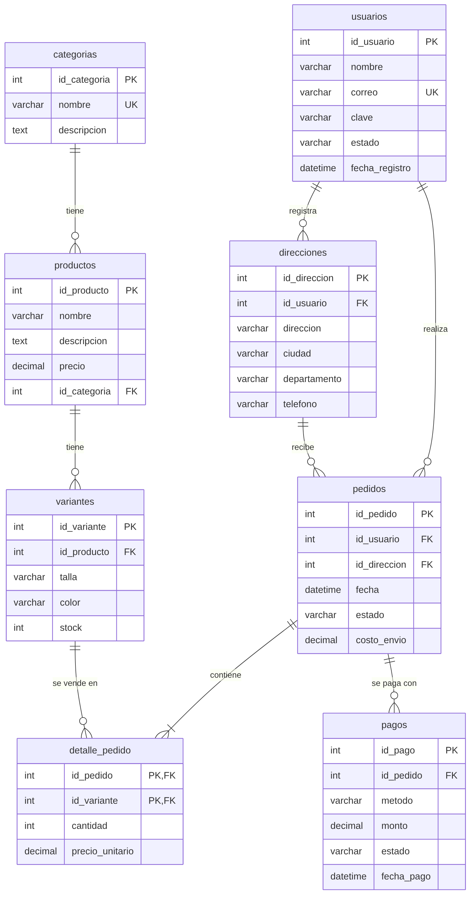

## Pruebas en Postman
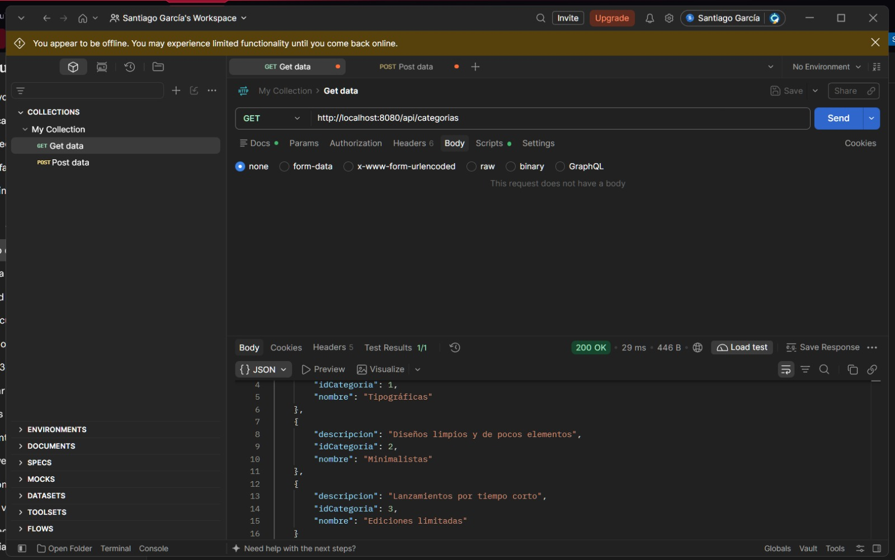
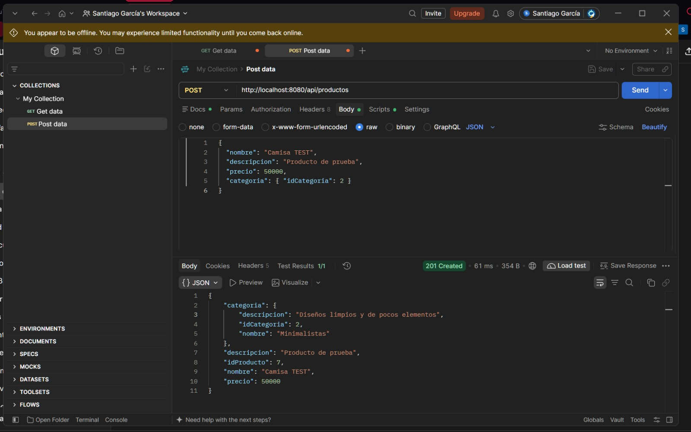
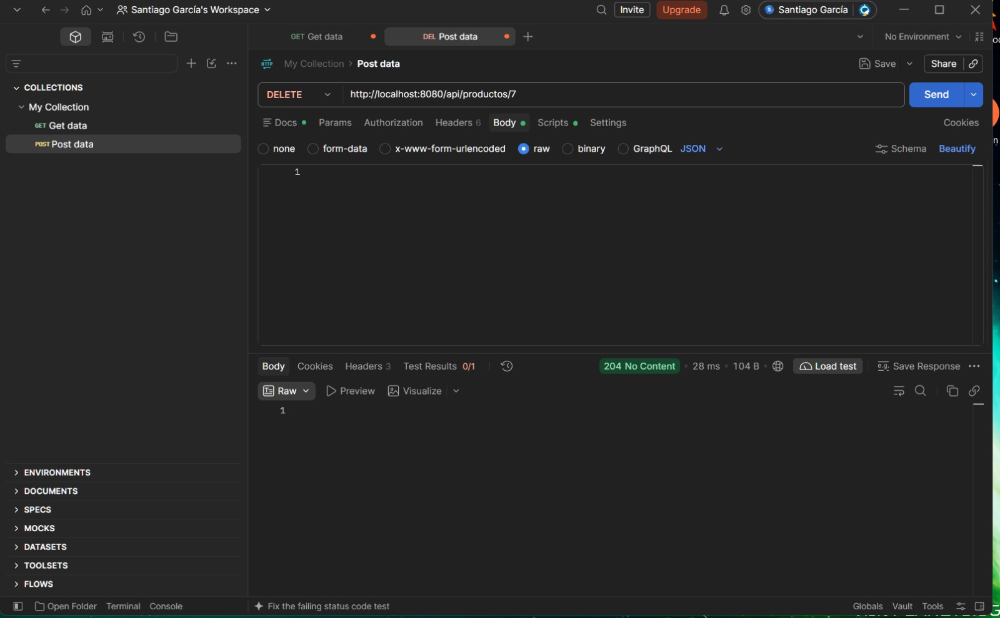
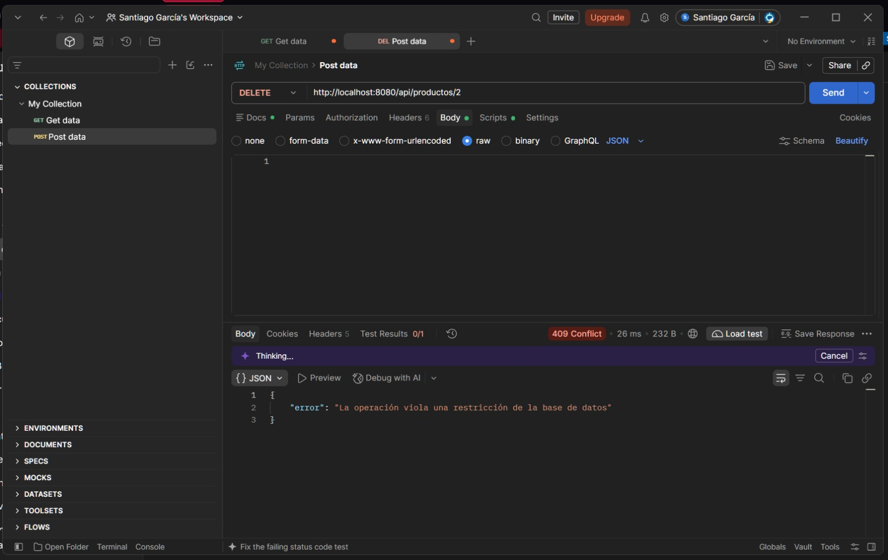

## Repositorios del proyecto
| Repositorio | Descripción |
|---|---|
| [Cool-Store-API](https://github.com/MacacoCol/Cool-Store-API) | Backend Spring Boot + MariaDB (este repo) |
| [Cool-Store-React](https://github.com/MacacoCol/Cool-Store-React) | Front en React que consume esta API |
| [Cool-Store-Sena-](https://github.com/MacacoCol/Cool-Store-Sena-) | Front inicial en HTML, CSS y JavaScript |

## Evidencias del proyecto
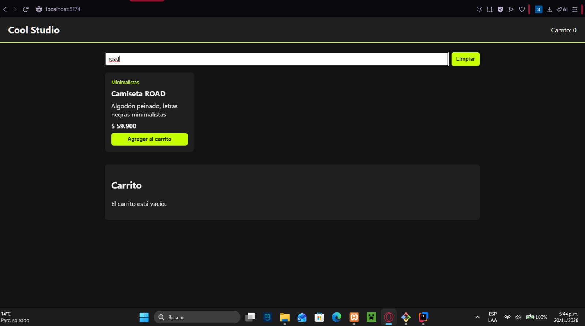
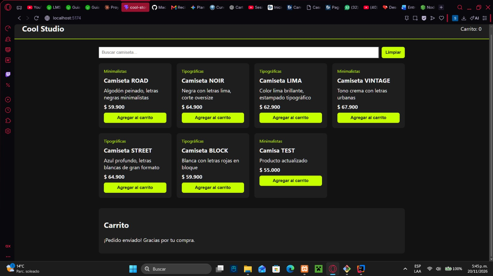
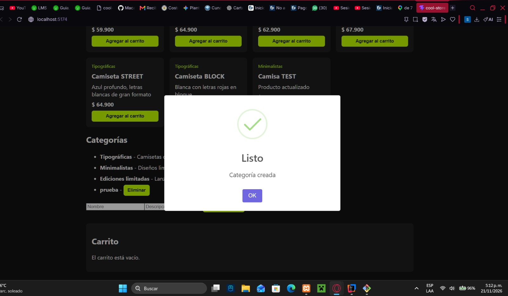
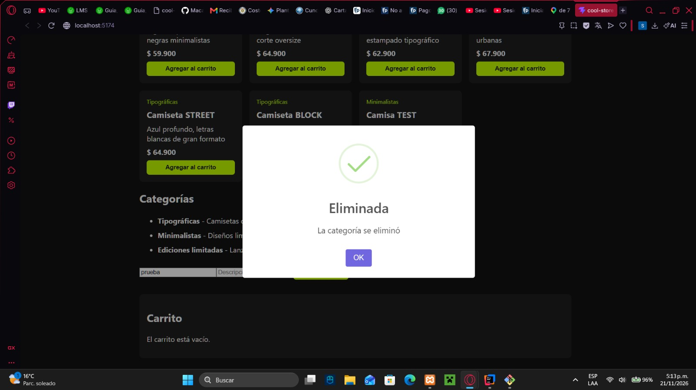
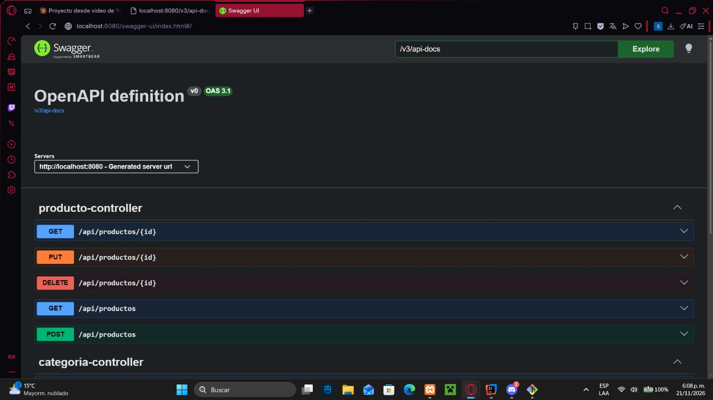
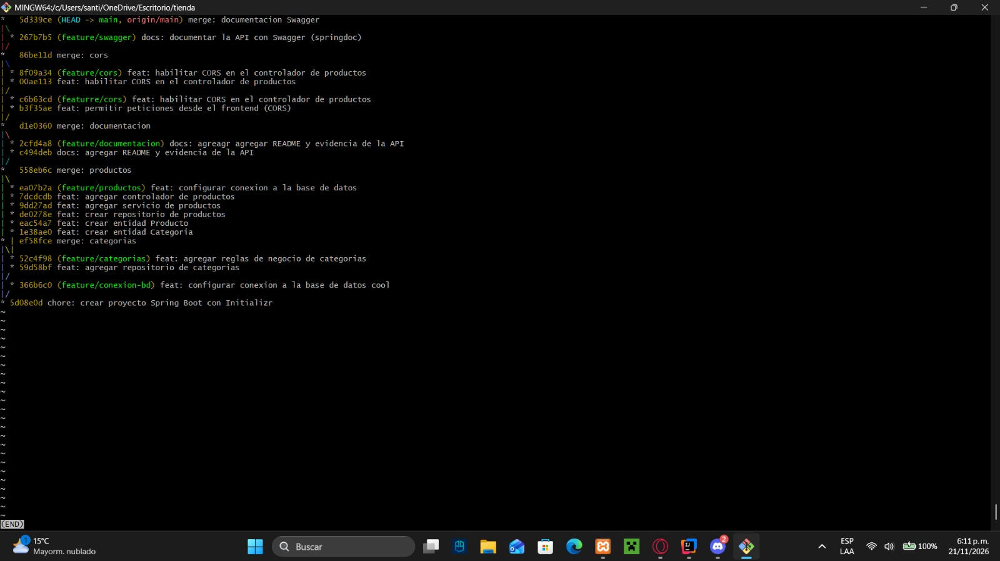
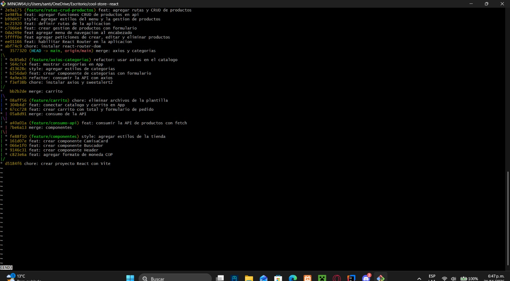
## Autor
Santiago García Castañeda